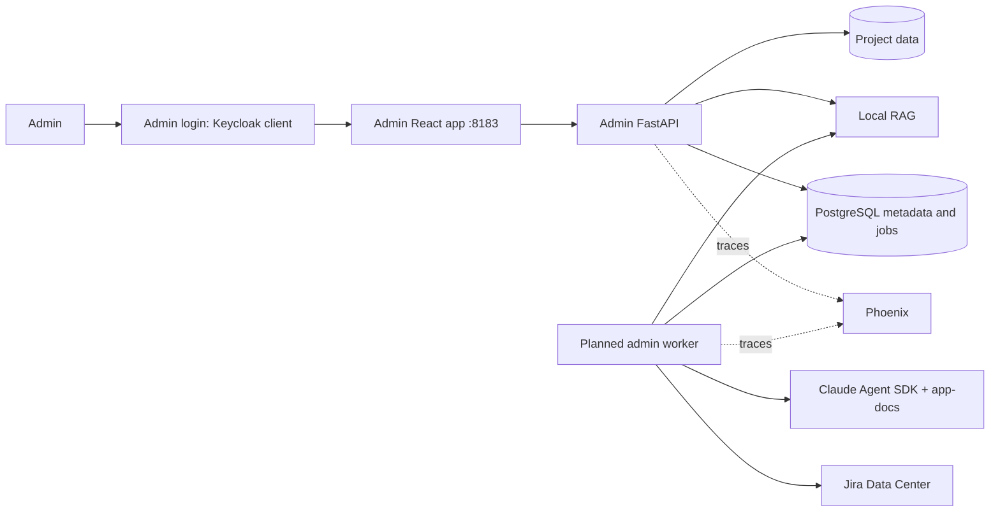

# Architecture and admin workflows

The current deployment is a single workspace. Administration has no application selector or application-prefixed URLs; the API binds all operations to the existing database identity. RAG reads `DATA_ROOT` (mounted read-only at `/work/data`) directly and writes only `JIRA_FOLDER`, without a UUID subdirectory. Administration is the only web application; the former Reader application was removed.


Status: target design, with an independently runnable v2-derived baseline now
ported into v3. GitHub settings, encrypted tokens, repository pull jobs, and service
inventory with repository/server relationships, server metadata, and Jira
settings/recent-ticket retrieval are implemented; the other
management workflows below remain target design.
See the root README for the current runtime. Jira target
confirmed by the user: **Data Center / self-hosted**. PostgreSQL and the sibling
v3 project are implementation choices made for this first phase.

## Runtime structure

Run one React/TypeScript administration application with shadcn, React Router,
and Tailwind, with its own FastAPI process, web container, authentication proxy,
Keycloak client and session cookie. It requires `docs-admins` throughout. Keycloak
is the identity provider; existing administrators keep their accounts. The former
end-user Reader application was removed and will be redesigned later. Repository pulls run in a worker owned by the admin
backend. PostgreSQL supplies durable jobs; no extra queue broker is needed yet.



Current source layout:

```text
services/admin-ui/             Standalone React administration application
services/admin-api/            Standalone FastAPI administration service
  src/knowledge_admin/         Admin-only app, route definitions and CLI
services/rag/                  Retrieval engine, document processing and retrieval
services/code-graph/           CodeGraph indexing/query scripts bundled into admin-api
plugins/app-docs/              Preserved plugin, explicit SDK loading
db/migrations/                Ordered application migrations
deploy/                       Separate web/API/auth services and shared infrastructure
```

The admin service owns its configuration (`knowledge_admin/config.py`). It currently provides
initialization, audit, repository, service-inventory and server-inventory
APIs, plus Jira settings, connection tests and recent-ticket retrieval. Document and server-access modules will be added there. Keep each workflow direct and avoid a separate service
for every settings page. The frontend apps have no cross-package source imports.

## Admin navigation

The sidebar has a project switcher and these sections.

| Page | Main content and actions |
| --- | --- |
| Projects | Create/edit/archive project, project members |
| Repositories | Repository links, requested branch/ref, local sync status, commit, Sync button |
| Services | Application details, many-to-many repository links, server/environment deployments, operational notes and agent context |
| Documentation | Select documentation set and its downloaded repositories; Generate, Upload, browse/download Markdown, delete files, Load into RAG |
| RAG | Current generation, indexed file revision, model, counts, stale status, job history |
| Jira / Tickets | Implemented: fetch 1–200 recently updated tickets, saved snapshot, original Jira links. Planned: custom JQL and incremental sync |
| Jira / Settings | Implemented: Data Center URL, username, encrypted PAT, Test connection |
| Servers | Implemented: register/edit name, hostname/IP, description, tags and search. Planned: SSH port/user/key, host key, Allow sudo, enabled state, Test connection |
| Jobs | Queued/running/completed jobs, persisted progress, actionable plugin questions |
| Agent runs | Agent run records (`/activity/runs`); configuration/job events planned |

Use a Sidebar shell, Table listings, Field/FieldGroup forms, Switch for sudo,
Dialog/Sheet for edits, and Alert/Empty/Spinner for state feedback. Use v2's
existing shadcn components where suitable and install missing components via its
CLI. The file table includes path, origin, revision, changed time, and indexed
state. Generated and uploaded documents appear in the same set.

## Service inventory and agent context

`ka.services` identifies a logical application within a configured project.
`ka.service_repositories` links any number of source repositories; repositories
can be shared. `ka.service_deployments` identifies where each service runs, with
separate server, environment, runtime identifier, port, log location and reported
version. This avoids repeating source links across production/staging deployments.
Composite foreign keys prevent cross-project links. Saves replace associations
atomically; optimistic revisions detect stale forms and retain deployment IDs.

The Servers page manages name, hostname/IP, description, tags and an SSH allowed switch; Services can
register a host with the same form before credentials exist. Updates require the
current revision and keep service deployment links. The public `ka.server_assets`
view also supplies the latest metadata to nested service context. Such
records have `enabled=false`, `username=NULL`, and `allow_sudo=false`. The separate
`ssh_allowed` permission defaults false and is included in service context; changing
it does not configure or activate an SSH connection. The database
requires a username before server access can be enabled. No registration or
service-save path opens SSH, executes commands, pulls repositories, or probes URLs.

`ka.service_assets` is the public projection consumed by the UI and
`GET /api/services/{id}/context`. The context response includes a schema
version, generation timestamp, and explicit operator-maintained provenance.
Only downloaded repositories expose checkout paths; `current_commit` is distinct
from the operator's `deployed_version`. Credentials are not joined into this view.
The API requires the same global admin authorization as other management routes.

This resource is ready for a future agent-run adapter; current agents do not
consume it automatically. Live observations, evidence timestamps,
SSH/log collection, health checks, and monitoring remain separate work. Consumers
must use a trusted authenticated boundary and treat descriptive text as untrusted
data, never as executable commands or grants of access.

## Claude Code worker

Interactive documentation sessions run in `claude-code-worker`, one Claude Agent SDK
client per session (`knowledge_admin.claude_code_worker`), claimed from PostgreSQL with a
lease. Isolation:

- Network: only the `claude-code` network, shared with `postgres`; internet egress
  remains for the model provider. Bash cannot reach `admin-api` (which trusts the
  proxy's user headers) or any other service.
- Files: `DATA_ROOT` read-only; the only writable mount is `claude-code-home` at
  `/home/claude` (root-owned, 0711). Files under `DATA_ROOT` must be readable by the
  claude users (world-readable, or group-readable by gid 1001).
- Users: the worker runs as root and keeps the database password and encryption key
  out of the CLI environment. Each running session holds a worker slot (at most 8,
  `CLAUDE_CODE_MAX_SESSIONS`), and `knowledge-claude-cli` runs the CLI as that slot's
  user (`claude1`..`claude8`), so one session cannot read another's process environment
  or files. HOME is per session (`/home/claude/sessions/<id>`, 0700); before dropping
  privileges the wrapper hands it to the slot's user (CAP_CHOWN only), so a resumed
  session finds its transcript in any slot, and it kills processes an earlier session
  left under that uid.
- Secrets: the session's key reaches only the CLI environment; every enabled Claude
  connection's key is redacted from run events, drafts and error messages, and NUL
  characters are removed before storing.

## Code projects and Git synchronization

`ka.repositories` now represents code projects: a name and description, optional
Git source, and one or more `ka.code_project_folders` mappings inside `CODE_ROOT`.
Agent/service selections retain their existing project IDs. Administration browses
the code mount read-only; the repository worker has write access.

Saving a Git project specifies an unused relative clone folder and whether to
clone immediately. Manual pulls and optional periodic pulls create the same durable
`repository_sync` jobs. The worker schedules due projects from PostgreSQL and
serializes jobs per project. New clones stage under `.ka-sync/<id>` before moving
to the chosen folder. Later pulls update the same detached checkout after checking
that its HEAD, origin and working files still match the managed clone. Local
changes stop the pull. HTTPS URLs and refs are validated; authentication uses
write-only encrypted token records and transient askpass without token URLs.

Only a valid job lease can publish the successful commit, checkout path, folder
mapping and sync status. Existing snapshot-style projects keep their old folders
and IDs; editing one adopts its current checkout as the fixed clone path. Mapping
changes never remove source files. No automatic cache/snapshot cleanup is added.

## Generate documentation through Claude

The worker loads the bundled plugin directory via the SDK's local `plugins`
option and explicitly invokes `/app-docs:docs build` or `update`, passing the
prepared source-root and docs workspace. This is supported by the
[Claude Agent SDK plugin documentation](https://code.claude.com/docs/en/agent-sdk/plugins).

Capture the selected repository commits, plugin version/digest, starting
documentation revision, and SDK session ID in the generation record. Prepare an
isolated control directory, read-only sources, and a job-owned writable docs Git
worktree seeded from the current file manifest. The API, not the agent, creates
the repositories/worktrees. Empty bootstrap commits are local worker state.

The v2 plugin's [interview workflow](../plugins/app-docs/references/interview-workflow.md)
requires a clean Git tree, prepares drafts, asks questions, and writes after
confirmation. It also invokes `rag index` for chunk validation. The admin adapter
must explicitly supply this invocation contract before the feature ships:

- Generate authorizes analysis and draft writes within the job workspace. Reuse
  the plugin's Diátaxis rules, source citations, incremental update logic, and
  chunk contract. Supply this user authorization in the run context; do not
  simulate user approval events or claim unattended support for the unchanged
  interactive plugin.
- Prepare the full draft first. Persist any real questions about intent as
  `job_questions`; set `waiting_input`, release the worker lease, and resume from
  persisted SDK state after the admin answers. Unknown/deferred facts remain
  visibly marked. The adapter must be tested for the plugin's confirmation turn.
- Validate chunking only in a disposable job index with no active collection
  pointer. Generation must never automatically publish live RAG data.
- Persist output bytes and hashes, validate relative Markdown paths, then merge
  the accepted output as one new document-set revision in a DB transaction.
  Lock the document-set row and compare `base_revision`. A concurrent upload
  causes a conflict with a reviewable draft, never silent overwrite.
- An uploaded file is user-owned. If generated output targets it, preserve the
  upload and surface the proposed replacement for explicit selection in the UI.
  Omitted files are not implicitly deleted; deletions belong in the proposed
  manifest and must preserve uploaded content unless explicitly selected.

The documentation writer must have its own SDK permission policy. Scope writable mounts to job output, keep
application code read-only, and keep unrelated Jira/SSH credentials out of the
Claude worker subprocess environment.

## File uploads and directory consistency

`<upload root>/docs/<project-id>/<set-id>/` is the human-readable Markdown folder.
Immutable bytes live at `<upload root>/blobs/<project-id>/<revision-id>`. Database
file pointers are authoritative; the docs folder is a materialized view and is
repairable from those pointers after a crash.

Initial upload support is UTF-8 `.md`/`.markdown`, matching v2's actual ingestion
format. PDF/Word conversion is a later explicit feature, not a silent promise
that the Markdown index can consume arbitrary binaries.

Upload writes a temporary blob, validates size/type/path, durably renames it,
then locks the set and atomically creates the immutable revision, changes the
file pointer, increments the set revision, and appends an audit event. Batches
increment once and succeed or fail together. Resolve paths under the managed
root and reject symlinks, reserved internal directories, and traversal after
URL decoding; the SQL path domain is only a second check. File replacement is
an explicit upload option; conflicting names return a useful conflict response.

Deletion marks the file deleted and increments the set revision. Files omitted
from an upload remain present. The next RAG load indexes the **entire current
non-deleted Markdown manifest**, including retained files. This is the intended
meaning of replacing RAG, rather than treating every upload as a full directory
replacement. Out-of-band filesystem changes require an explicit import/reconcile
operation before they become current database revisions.

## Document processing and search

The fixed source mount is `/work/data` (`DATA_ROOT`, read-only; only the Jira folder is writable for RAG). PostgreSQL stores folder descriptions, file manifests, parsed chunks, full-text indexes, and pgvector embeddings. File content and processing-profile hashes determine which stages need to run. Unchanged parsing and embeddings are reused; changed and deleted files are published atomically. See [RAG administration](rag.md).

The search agent receives the indexed document catalog with short descriptions on every turn. It calls `/search` for retrieval and reads full documents when needed. Source-code questions use read-only analysis of checkouts published by the repository worker. Administrators try agents in the agent Test page; conversations are scoped to the authenticated user. Phoenix tracks the agent execution.

## Jira Data Center

The implemented panel stores a base URL (including any Jira context path), token
owner username and encrypted PAT. It calls `/rest/api/2/myself` and
`/rest/api/2/search` with a Bearer PAT, preserves paths such as `/jira`, verifies
the username, and does not follow redirects. The ticket list fetches 1–200 issues
with `ORDER BY updated DESC, key DESC`, handling server page-size limits. See
[Jira setup, mock isolation and API contract](jira.md) for the current adapter.

Tickets are imported from Jira into the local admin list. No Jira issue creation,
comments, or remote edits are implied. The current fetch paginates `startAt/maxResults`,
returns retryable rate-limit errors, and upserts on `(connection_id, remote_id)`; issue
keys can change. Keep display columns alongside the original JSON. Jira comment
or attachment subresources require separate paginated fetches if later added;
`raw_payload` is not a guarantee that every subresource was downloaded.

Future incremental synchronization should advance its watermark only after all pages succeed, using the
run-start timestamp and an overlap window for late changes. Partial failures
must not mark unseen tickets deleted. Full reconciliation can mark tickets out
of the configured scope after all pages succeed; absence does not prove remote
deletion. Changes to JQL reset the incremental cursor and require full sync.
Current reads require the global admin group and the configured application scope.
Future non-admin access needs an explicit project-membership policy. Per-user Jira
permission replication is a separate capability.

The schema also permits Cloud settings without requiring Cloud support in the
first adapter. Cloud uses distinct token authentication and
[enhanced JQL search](https://developer.atlassian.com/cloud/jira/platform/rest/v3/api-group-issue-search/);
do not reuse the Data Center pagination contract there.

## Server access settings

Store name, hostname/IP, port, username, SSH credential or explicitly configured
agent, trusted host keys, enabled state, and `allow_sudo` (default off). A draft
can be saved before its key is supplied; connection testing requires complete
configuration. Private keys are encrypted credentials, never ordinary form
response fields. Return `credential_configured` and masked metadata in the UI.

This phase models access settings and a future connection test. Arbitrary remote
command execution is not part of a settings save. Later server tools must read
the current enabled/sudo policy at execution time; enabling sudo is a permission
ceiling, not approval for all privileged actions.

## Authentication, tracing, and secrets

Preserve Keycloak + oauth2-proxy and the `docs-admins` global admin group. Trust
forwarded identity only at the private API boundary behind the authenticated
gateway, stripping incoming identity headers. Map stable `(issuer, subject)` to
`principals`; email changes must not create new users. If the v2 proxy identity
is not a stable subject, update the claim wiring during the auth port.

Global admins manage projects and membership. Project admins manage connections,
credentials, servers, and members; editors manage repositories/docs and jobs;
viewers read project content/chat. Enforce permissions server-side, including
SSE, downloads, RAG/MCP collection filters, and chat sharing. Composite foreign
keys prevent accidental cross-project references; they do not implement API
authorization. Direct RAG/MCP endpoints stay internal.

Application secrets use authenticated encryption with key version and associated
data `(project_id, credential_id, kind)`. Keep the master key outside PostgreSQL
and backups in a separate secret store. No decrypted secret or ciphertext goes
to list/detail responses, job JSON, logs, events, or traces. Runtime deployment
credentials for Keycloak, Phoenix, and model providers stay in deployment secret
files; they are not project connection rows.

Keep Phoenix/OpenInference tracing and extend it to jobs and code generation.
Use project/job/session identifiers as attributes and retain `trace_id` on jobs,
chat turns, and audit events. Phoenix owns span payloads and retention; do not
build a second trace database. A Phoenix outage must not block chat or jobs.

## Folder workspace RAG

The standalone RAG API also owns a PostgreSQL-backed folder workspace and a dedicated durable processing worker. The admin API authenticates administrators and injects project scope into RAG calls. Compose fixes the source mount, while backoffice settings control processing and model configuration without restarts. See [the RAG architecture and API guide](rag.md).
