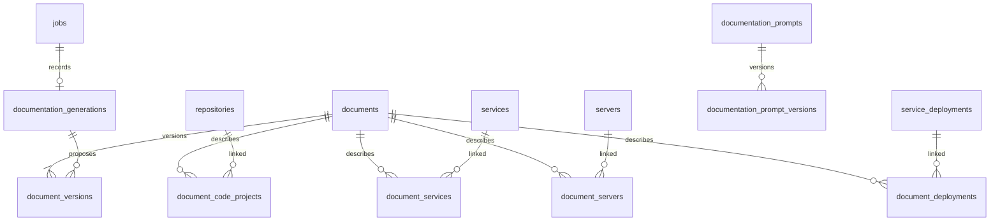

# Database model

Executable definitions are in [db/migrations](../db/migrations), through
[0043_service_dependency_context.up.sql](../db/migrations/0043_service_dependency_context.up.sql).
PostgreSQL 17, application schema `ka`, UUID identifiers, UTC-aware timestamps.
Enum-like values use CHECK constraints so future migrations can change them
directly. golang-migrate stores the current version and dirty flag in
`public.golang_schema_migrations`; adopted databases retain the former
`public.schema_migrations` checksum ledger as evidence. See the
[migration guide](migrations.md).

## Current ownership and storage

The application exposes one configured workspace. Inventory and document links
retain composite workspace foreign keys for integrity; the UI has no application
selector. Keycloak identities and Phoenix traces remain external state.

| Tables | Stored information |
| --- | --- |
| `projects`, `principals`, `project_members` | Workspace identity and attributed administrators |
| `credentials` | Typed encrypted credentials and rotation metadata |
| `repositories`, `code_project_folders` | Code projects, optional Git sources, one or more mounted folders |
| `services`, `service_repositories`, `service_deployments` | Applications, source code and server/environment deployments |
| `service_dependencies` | Directed dependencies between services, with a description of each relationship |
| `servers` | Host inventory and SSH connection settings |
| `documents`, `document_versions` | Stable document IDs, canonical Markdown, immutable versions, hashes and source snapshots |
| `document_code_projects`, `document_services`, `document_servers`, `document_deployments` | Current document associations to inventory |
| `documentation_prompts`, `documentation_prompt_versions` | Editable analysis templates, draft versions and explicit active selection |
| `documentation_generations` | Immutable generation input snapshots associated with jobs; execution is a later stage |
| `jobs`, `job_events`, `job_questions` | Work lifecycle, worker leases, input/results, progress and questions |
| `rag_workspaces`, `rag_collections`, `rag_files`, `rag_file_log`, `rag_chunks`, `rag_vectors` | Global RAG settings; `ka.rag_collections` (the searchable unit: its own search and processing settings; its folders are in `ka.rag_collection_paths`); per-collection file hashes, per-file status (`rag_file_log`), searchable text and cached embeddings |
| `agent_collections`, `agents.all_collections` | Which RAG collections an agent may search and read (whole collections; `all_collections` grants every one) |
| `rag_folders` | Kept only for old processing-job history; nothing new writes to it |
| `jira_connections`, `jira_tickets` | Jira Data Center access settings and imported tickets |
| `agents` and agent configuration/association tables | Agent definitions, prompt/model assignments, skills, tools and resources |
| `agent_sessions` and associated tables | Shared test/live session state and conversation history |
| `audit_events` | Immutable attributed configuration events |

See [documentation administration](documentation.md) for the document model,
version lifecycle and API. Migrations 39–40 replace the old, unused document-set,
plugin and RAG-collection pipeline; they refuse to discard populated legacy data.
The current RAG collections pipeline is unaffected.
Migration 41 seeds the editable app-docs analysis template with active version 1,
including when the application workspace is first created after migrations.



## Database and API guarantees

Composite foreign keys keep related inventory and credentials in one workspace.
Credential types prevent using a Jira token as an SSH key. The backoffice encrypts
secrets before storage and exposes only their configured state.

Documents require a current version belonging to that document. Every save takes
a row lock, checks the submitted revision and inserts a complete version. Saved
Markdown is immutable and its SHA-256 must match its UTF-8 bytes. Current resource
links are foreign keys; historical names and IDs stay in each version's snapshot.
Prompt activation also uses a parent lock and expected revision. Saved prompt text
cannot be changed, and the active version cannot be deleted independently.

Jobs enforce lifecycle timestamps and leases. Except for multi-output document
generation, a job has exactly one typed inventory target. Partial unique indexes
prevent overlapping work for the same repository, Jira connection or server.
Terminal jobs and audit events are immutable. Job creation and its input snapshot
must commit in one transaction. Workers compare lease tokens and expiry before
completion. See the code for each running worker's implementation.

Code and RAG roots are mounted deployment settings. PostgreSQL stores managed
Markdown as well as RAG text and vectors; raw RAG source files remain in RG_DATA.
Managed document publication into RAG is not yet enabled.

## Environments

Migration 45 adds `ka.environments` with a stable UUID, name, description, revision,
creator and timestamps. Names are unique within the workspace, ignoring case.
`environment_services` and `environment_servers` are many-to-many membership tables;
each service or server can belong to multiple environments. Composite foreign keys
require the environment and its members to belong to the same workspace.

`environment_assets` provides ordered service/server summaries for administration
without exposing server credentials. The admin-only `/api/environments` routes
support list, create, read by ID, replace and delete. Saving replaces the submitted
membership lists atomically and requires the current revision when editing. Deletes
require confirmation and the current revision, remove membership links, and retain
services, servers and deployment records. Deleting an asset removes its membership
links without removing the environment. Creation, updates and deletion are audited.

The Environments page lets operators name and describe environments, search/select
multiple services and servers, inspect membership, filter environments by members,
and delete with a shadcn confirmation dialog. Empty environments are supported.
The migration starts with no environments; it does not infer membership from existing
deployment labels. Membership does not grant agent access or imply any service-to-server
deployment or dependency.

Migration 50 adds `service_deployments.environment_id`, a foreign key to an environment
in the same workspace, and exposes environment memberships in `service_assets`.
The Services form has a dropdown with multiple environment selections and a single
environment dropdown per deployment. Multiple deployments can place a service in
different environments. Saving a selected deployment also adds its service and server
to the corresponding environment membership. Removing a deployment preserves membership;
it can be deselected explicitly afterward. Environment edits cannot remove members
still used by linked deployments. Reciprocal membership changes advance revisions so
stale forms cannot silently replace another editor's selections.

Existing deployment labels that exactly match an environment name are linked by ID;
unmatched labels and deployment/document IDs are preserved. No environment or membership
is invented by the migration. New UI selections send IDs, so environment renames appear
in deployments and document resources automatically. The original `environment` text
is retained for legacy API clients and unlinked records. Deleting an environment clears
the foreign key and retains the latest name and deployment record.

Rollback refuses to discard saved environments. With the environment tables empty,
rollback and reapplication preserve the existing inventory.

## Service classification

Migration 44 adds two independent PostgreSQL enums to `ka.services` and exposes
them in `service_assets`, the service list and the context API:

- `service_type`: `unclassified`, `custom`, `builtin`, `external`. This describes
  software origin: our application, third-party software such as Nginx or
  PostgreSQL, or a service operated outside the system.
- `service_role`: `unclassified`, `application`, `proxy`, `web_server`, `database`,
  `cache`, `message_broker`, `worker`, `other`. This is the primary architectural
  role, independent of who builds or operates the software.

Existing records become unclassified; the migration does not infer values from
names. New service forms start with Custom application / Application. Forms edit
both fields, list filtering includes their labels, and both TALA and Dagre use
role-based node colors with role labels and a legend. Built-in and external
services can be saved without linking source code or a deployment.

API updates that omit either field preserve its saved value. Invalid values are
rejected by both request validation and the database, and changes are included in
the service audit record. Rollback preserves inventory and refuses to discard
classified values until they have been exported or explicitly cleared.
Environment-scoped architecture is a separate upcoming change.

## Service dependencies

Migration 42 adds `ka.service_dependencies`. A row means `service_id` depends on
`depends_on_service_id`; for example, Orders API depends on PostgreSQL, with the
description "Stores orders and transaction history." Both IDs reference existing
services in the same internal workspace. The composite primary key allows several
dependencies per service and several services to share one dependency, while
rejecting duplicate links. Self-dependencies are rejected. Mutual dependencies and
longer cycles are allowed because these are inventory facts, not a scheduling DAG.

The description is optional (up to 4,000 characters). Creation and update timestamps
are stored, and updates refresh `updated_at`. The primary key supports finding a
service's dependencies; an index on `depends_on_service_id` supports finding its
dependents. Deleting either service removes the relationship without deleting the
other service. Editing a service preserves its existing dependency links.

The migration creates an empty table and preserves existing inventory. Rollback
refuses to discard populated dependency data. Migration 43 adds `dependencies`
and `dependents` to the `service_assets` projection. Its rollback restores the
previous view while preserving dependency records.

The Services form edits both **Depends on** and **Used by**, with searchable
multi-selection and an optional description for each link. Both directions edit
the same table row; changing either end is reflected in the other service's
details and form. Self-selection is excluded. The details view, service context
endpoint and agent service configuration include both directions.

The **Dependency graph** tab is under **Environments**. Open an environment's
Graph button or choose one at `/environments?view=graph`. Deep links include
`environment_id=<uuid>`. The graph defaults to **TALA** and shows only services
selected in that environment, including unconnected members. Both ends of each
displayed dependency must belong to that environment. Arrows point from the service
to its dependency; inverse `dependents` entries are not drawn again. Dependencies
still come from the shared service inventory, rather than separate environment
relationship records. The relationship table shows full descriptions and opens
service details. Empty or unavailable environments never fall back to a global
graph. Services remains the inventory/CRUD page. Mermaid remains the document/chat
diagram renderer.

TALA generates D2 from the saved services and dependencies. D2.js 0.1.34 (D2 0.9.0)
runs node layout and arrow routing in a browser worker, then displays the SVG as
an image in a React Flow viewport with pan, zoom and fit controls. The engine is
loaded only when opening this view, runs locally without sending inventory to
another service, and is disposed after rendering, cancellation or a 60-second
timeout. Service labels are quoted and variable substitutions escaped. Environment
selection and layout are kept in the URL; switching environments resets the canvas.

**Interactive (Dagre)** remains available with `layout=dagre` on the environment graph.
It arranges services from left to right and allows dragging individual services,
opening details from their names, and restoring the layout. Moving nodes affects
only the current view and never changes saved relationships.

`POST /api/services` and `PUT /api/services/{id}` accept `dependencies` and
`dependents`, each an array of `{service_id, description}`. The ID is the other
service: for `dependencies`, the saved service is the source; for `dependents`,
it is the target. Each list allows up to 100 distinct services, and the same
service may occur in both directions for mutual dependencies. Omitted lists
preserve that direction; explicit empty lists remove it. Foreign/missing services,
self-links and duplicate selections are rejected before any changes commit.

Service writes serialize on the workspace row using `FOR NO KEY UPDATE`, then
check the existing service revision. Changed relationships increment the other
affected services' revisions too, including when deletion removes their links.
An old form cannot overwrite a relationship edited from the opposite service.
Unchanged links retain their description and timestamps; unrelated relationships
remain untouched. The attributed service audit event includes affected service IDs.

## Worker claim pattern

Use a transaction and a new lease token per claim. The example's lease duration
is illustrative; production sets one worker lease/heartbeat policy.

```sql
WITH candidate AS (
    SELECT id FROM ka.jobs
    WHERE status = 'queued'
    ORDER BY created_at, id
    FOR UPDATE SKIP LOCKED
    LIMIT 1
)
UPDATE ka.jobs AS job
SET status = 'running',
    started_at = COALESCE(started_at, clock_timestamp()),
    attempt = attempt + 1,
    worker_id = $1,
    lease_token = gen_random_uuid(),
    lease_expires_at = clock_timestamp() + interval '60 seconds'
FROM candidate
WHERE job.id = candidate.id
RETURNING job.*;
```

`SKIP LOCKED` is appropriate for consumers of a queue, as described in the
[PostgreSQL SELECT documentation](https://www.postgresql.org/docs/17/sql-select.html).
Commit the claim immediately; do not hold a database transaction open during
Git, Claude, SSH, Jira, or embedding calls. Persist resumable questions and
release the lease on `waiting_input`. Terminal retries create a new job row.

## Current code project API

Migration `0026_code_projects` extends `ka.repositories` to represent local or
Git-backed code projects and adds `ka.code_project_folders`. Historical table and
foreign-key names remain to preserve IDs and agent/service/job links. Existing
checkout paths are backfilled as folder mappings. A Git project has one source
URL and clone folder, plus optional extra mapped folders. Local projects have no
remote URL or credential. Folder paths are relative to `CODE_ROOT`.

Administration exposes `GET/POST /api/code-projects`,
`PUT /api/code-projects/{id}` and `POST /api/code-projects/{id}/pull`.
Saves replace folder mappings atomically; updates require the current `revision`.
Clone destinations must be unused and cannot overlap other projects. Pulls of
local-only projects are rejected. `clone_now` queues a job when saving; a nullable
`sync_interval_minutes` configures the worker's scheduler (5–10080 minutes).
Tokens are write-only: omitted preserves, explicit null removes. The historical
`/api/repositories` routes remain compatible for existing clients.

`GET /api/code/files?path=&offset=0` lists entries in pages of 200. The optional
`folders_only=true` filters to directories before pagination for the form's folder
tree, excluding symbolic links and Git/worker internals. The response
includes the configured host and container mount paths, total entries and next
offset. `GET /api/code/file?path=...` previews UTF-8 text up to 512 KB. Both are
admin-only, read-only, and reject paths outside the mount and symbolic links.

The worker claims jobs for eleven minutes and bounds Git work to ten minutes.
New clones use the configured folder; subsequent pulls update it after checking
for local changes. The worker publishes commit, checkout path, folder mapping,
sync time and terminal job status in one database transaction after checking its
lease. Older snapshot-style repositories retain their behavior until edited.

## Current service asset API

`GET/POST /api/services` lists and creates logical applications. `PUT` by
service ID replaces settings, repository links and deployments in one transaction,
requires the current integer `revision`, and returns 409 for a stale edit. Deployment
IDs are preserved when supplied and must already belong to that service. Names
are unique per project ignoring case. Unknown, archived or cross-project repository
links and cross-project server links are rejected without mutation.

`GET /api/services/{id}/context` returns the same public projection with
`schema_version`, `generated_at`, and provenance/usage annotations for future agent
consumers. This endpoint is admin-only and does not execute or monitor anything.
`GET/POST /api/servers` lists public server metadata or registers name/host,
description, tags and `ssh_allowed` (a strict boolean, default false). `PUT /api/servers/{id}` updates these inventory fields
with the current `revision`, rejecting stale saves with 409. Names retain their
existing per-project uniqueness rule. Tags are a non-null one-dimensional text
array (maximum 32); API validation also bounds each tag to 64 characters, rejects
empty tags, commas and control characters, and trims/lowercases/deduplicates them.
Existing records receive an empty description, empty tags and revision 1.
`ka.server_assets` selects only public inventory and access-policy fields. The
service projection embeds it, so edits appear in agent context without rewriting
deployments. Inventory saves preserve SSH configuration and audit each revision.
`DELETE /api/servers/{id}?revision=...&confirmed=true` removes an unreferenced
server and records `server.deleted` in the same transaction. The Servers page
uses a shadcn confirmation dialog showing the name and hostname. Missing
confirmation, stale revisions, and servers referenced by service deployments or
connection-test jobs/history are rejected; linked deployments must be removed
from Services before deletion. No commands are executed on the host.
Newly registered servers have no username/credential, access disabled,
and sudo disabled. The **SSH allowed** switch in the registration/edit form stores
`ssh_allowed` independently of connection configuration; its On/Off value appears
in the server list, service details and agent context. An edit that omits the field
preserves its saved value. Saves record it in the audit event and use the existing
revision check. Turning it on does not enable a connection, configure credentials,
grant sudo, or queue SSH commands. Enabling the separate connection configuration
still requires a username; full SSH settings and execution are pending.

Migration `0009_server_ssh_policy.up.sql` adds the non-null permission column with
false for existing and new records and extends `ka.server_assets`. The nested
service projection receives the new field automatically.

## Current Jira API

The admin manages one `primary` connection. `GET/PUT
/api/jira/settings` reads public settings or saves URL, username and an
optional write-only token. Updates require the current revision. `POST
/api/jira/test` verifies the active PAT owner and issue-search access.
Tests and edits create attributed audit events without storing tokens in details.

`POST /api/jira/tickets/fetch` accepts `limit` (1–200) and retrieves pages
ordered by updated time and key descending. It validates complete pages before
upserting stable remote IDs in a single transaction. Previously visible tickets
outside the fetched selection receive `out_of_scope_at`; their absence does not
indicate remote deletion. `GET /api/jira/tickets` returns only this selection
with snapshot metadata. A settings revision or fetch revision conflict discards
stale network results. Failed fetches do not replace the previous snapshot.

Server/user changes require a new token and clear the old cache; token changes
hide the old selection pending a successful fetch. Incremental watermarks are not
advanced by this bounded manual fetch. See [Jira panel and local mock](jira.md).

## Documentation administration API

The current CRUD endpoints are under `/api/documentation`; see
[documents and prompts](documentation.md). The old `/document-sets` and RAG
collection publication routes are retired. Document generation and RAG publication
will be added on top of immutable document versions.

## Folder RAG workspace

Migration `0006_rag_workspace.up.sql` adds five folder-workspace tables and the `rag_folder_index` job target, and enables pgvector in the PostgreSQL 17 image. Runtime settings, encrypted provider credentials, folder descriptions, successful file hashes, processed chunks, full-text vectors, and embedding cache entries now live in PostgreSQL. Collection/folder identity is logical rather than a separate physical table per folder. See [RAG administration](rag.md).

Migration `0007_rag_folder_deletion.up.sql` adds folder deletion markers, a unique path constraint for active folders, and durable source-cleanup status. Recursive deletion atomically cancels overlapping jobs, deletes indexed file/chunk rows, removes unreferenced vector-cache entries, and clears folder descriptions. Deleted identities remain only to support immutable job history.

Migration `0008_single_rag_workspace.up.sql` adds a unique constant-expression index to `rag_workspaces`, enforcing one workspace for the single source mount. Project IDs remain internal foreign keys, preserving existing repositories, Jira configuration, services, servers, credentials, RAG hashes and job history.

## SSH agent configuration scopes

Migration `0017_agent_server_configs` stores global defaults (`server_id IS NULL`) and optional server overrides in `ka.agent_configs`. The unique `(project_id, agent, server_id)` constraint uses `NULLS NOT DISTINCT`. Nullable instructions and nullable API skill selections mean inherit; explicit empty values clear that setting for the server. `ka.agent_config_skills` stores explicit assignments, while `inherit_skills` distinguishes inheritance from an empty selection. Global rows require explicit instructions and skills.

The settings revision and server allowlist remain in `ka.operations_settings` / `ka.operations_servers`. All config mutations are serialized against that settings revision. Effective per-server settings are snapshotted into each run; configuration changes block further commands from an older snapshot. Global defaults are created when the settings are initialized and have no delete API. Server overrides cascade when their server is deleted. Existing instructions and global skill selections are migrated before the old columns/table are removed.

Migration `0018_remove_operations_enable_switch` removes `ka.operations_settings.enabled`. The saved allowlist determines which servers the agent may access; an empty allowlist blocks execution. Server-level SSH permissions and sudo policy remain enforced.

## Agent skill assignments

Migration `0023_skills_agents` adds `ka.skills_agents(agent_id, skill_id, project_id)`. The primary key `(agent_id, skill_id)` prevents duplicate assignments; foreign keys reference `ka.agents` and `ka.agent_skills`. Both foreign keys clean up assignments when the referenced row is deleted. An index on `skill_id` supports reverse lookups. The migration moves agent-level assignments from the server-null configuration into this table and preserves server-specific overrides in `ka.agent_config_skills`. `agents.skills_enabled` controls whether assigned skills are included; disabling it does not delete assignments.

## SSH connection overrides

Migration `0024_agent_server_connections` adds optional complete SSH connection overrides keyed by `(agent_id, server_id)`, including username, encrypted credential reference, port, host verification, sudo permission, revision, and test status. Composite foreign keys enforce the server/credential project and SSH credential kind. Missing rows use server defaults; rows without a key explicitly disable authentication. Existing rows in other tables are preserved by the migration. Overrides cascade on server deletion; application cleanup removes unreferenced SSH credentials.
